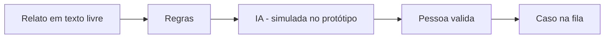

# Caso Claro

**Transforma "não funciona" em um caso que o time consegue resolver.**

Protótipo do Desafio de Inovação YouShop 2027, por Luan Figueiredo de Oliveira.

- **Protótipo online:** https://luan-f-oliveira.github.io/caso-claro/ (dados fictícios, IA simulada)
- **Apresentação (11 slides):** https://luan-f-oliveira.github.io/caso-claro/apresentacao.html
- **Pesquisa e fontes:** [research.md](research.md)

## Teste em 1 minuto

1. Abra o protótipo e clique em **Usar exemplo**, depois em **Analisar relato**.
2. Responda as perguntas (ou deixe algumas em branco, para ver o alerta de completude baixa) e clique em **Montar caso**.
3. Clique em **Aprovar e enviar à fila** e veja o caso na aba **Fila de casos**, onde há busca, filtro e avanço de status.

## O problema

Relatos como "minha venda não apareceu" chegam incompletos a Atendimento, QA e Desenvolvimento, e o time precisa refazer perguntas até ter um caso que dê para reproduzir.

- **De onde vem:** a descrição das áreas no próprio desafio, minha experiência de atendimento na FIBRAMAR (2023–2024) e 9 queixas públicas de afiliados no Reclame Aqui (Mercado Livre, Braip e Shopee; detalhes em `research.md`).
- **O que não sei:** a frequência desse problema na YouShop. Não entrevistei ninguém nem tenho dados internos. Isso é uma hipótese a validar.

## A solução



| Etapa | O que faz | Usa IA? |
|---|---|---|
| Regras | Escolhe a categoria, confere os campos obrigatórios, calcula a completude e mascara e-mail, CPF e telefone | Não |
| IA | Pergunta o que falta, resume o relato e redige o caso e a resposta ao creator | Sim (em produção) |
| Pessoa | Revisa e aprova antes de o caso entrar na fila | Não |

A IA não decide a causa. Hipóteses aparecem como "a verificar", e se os dados não explicam o problema, o sistema diz que não sabe.

## O que é real e o que é simulado

| Nível | Situação |
|---|---|
| Protótipo (este) | Interface, regras e fila em memória são reais. A IA é simulada (textos por modelo fixo) e todos os dados são fictícios. Sem integração com a YouShop. |
| MVP (próximo passo) | Servidor chamando um modelo de linguagem, só para casos de creators, sempre com revisão humana. |
| Produção | Integração com a ferramenta de atendimento, revisão de LGPD e monitoramento dos erros da IA. |

Nenhum número do protótipo é resultado real.

## Como medir se funcionou

Número que muda: **reperguntas por caso**. Apoio: % de casos completos na primeira abertura, tempo até a primeira ação do QA ou Dev e casos reabertos. Primeiro, duas semanas de linha de base; metas só depois.

## Limites e cuidados

- A IA pode errar, por isso uma pessoa valida antes de qualquer envio.
- Privacidade (LGPD): mascarar dados pessoais antes da IA e coletar só o necessário. Revisão jurídica antes de produção.
- O Caso Claro organiza o relato, mas não descobre a causa. Isso depende dos dados internos da plataforma.
- O creator deve saber que está falando com uma IA.

## Arquivos

- `index.html`, `styles.css`, `app.js`: protótipo (HTML, CSS e JavaScript puro, sem dependências e sem chaves de API)
- `apresentacao.html`: 11 slides 16:9 (imprimir em PDF com margens "Nenhuma")
- `research.md`: pesquisa, fontes e lacunas

## Executar localmente

```
python3 -m http.server 8000
```

Depois abra http://localhost:8000 (ou use o Live Server do VS Code).

## Publicar no GitHub Pages

Settings > Pages > Deploy from a branch > `main` / `/ (root)`. Para remover: desative o Pages ou apague o repositório.
